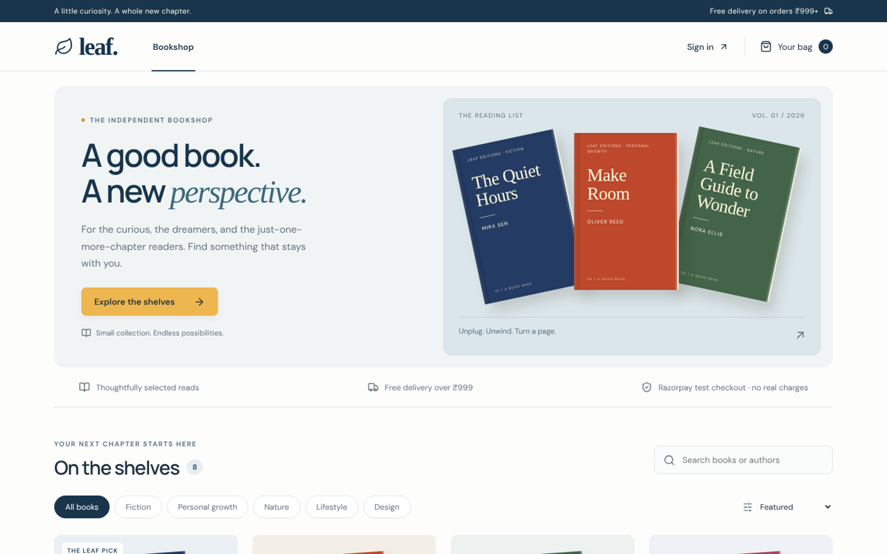
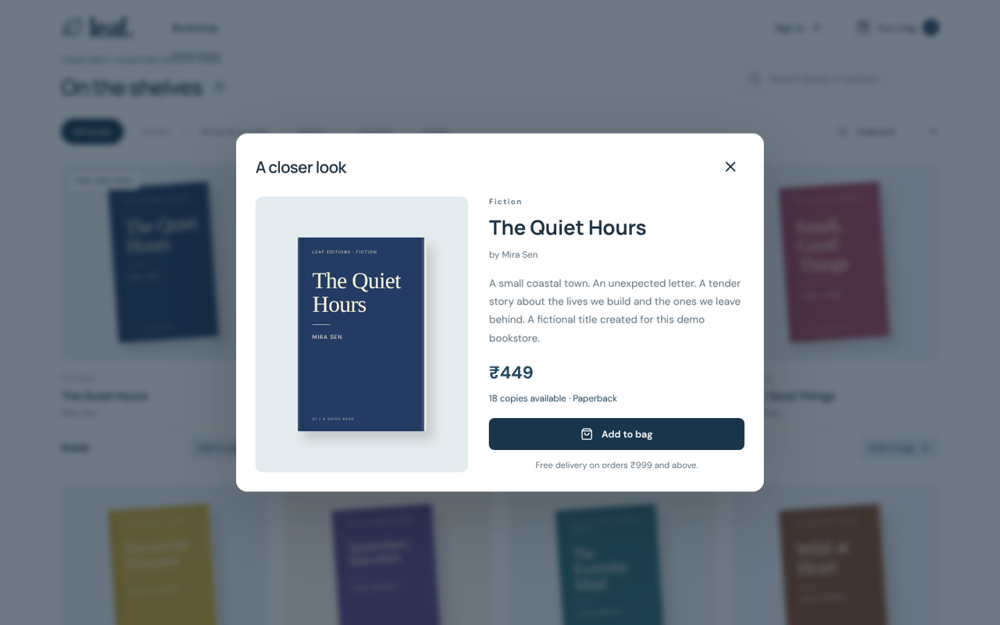
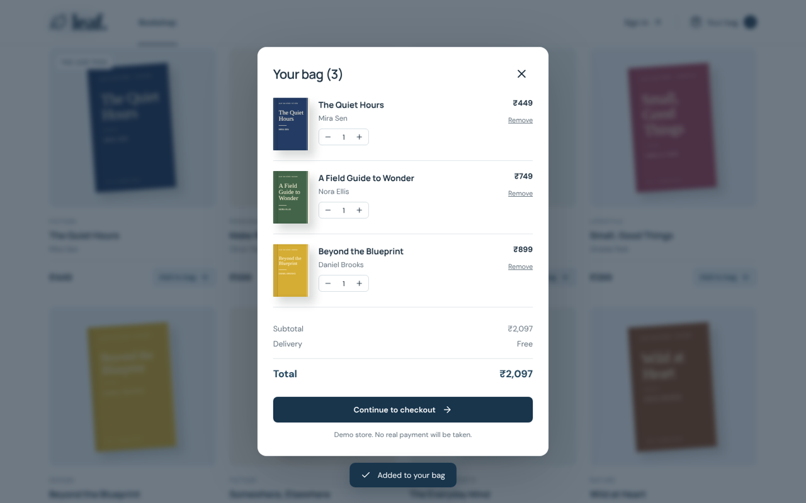
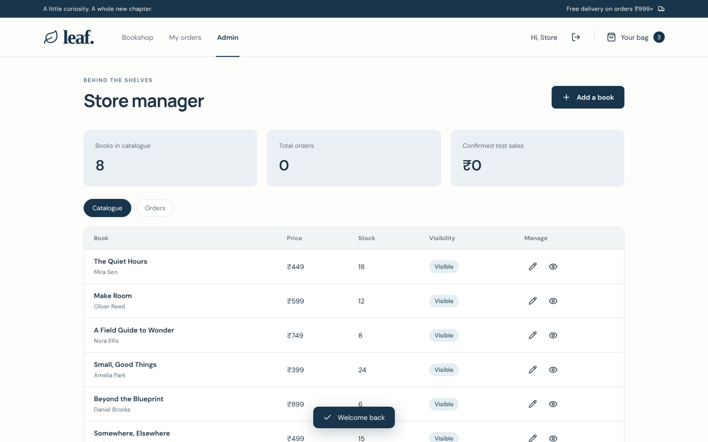

# Leaf Bookstore

An online bookstore with a customer storefront and a store-manager admin panel. Customers browse books, fill a bag, check out and track orders; the admin manages the catalogue, stock and order status.

Built with **Java 21 · Spring Boot 4.1 · Spring Security · JDBC · H2 · React 19 · Vite**, with Razorpay test-mode payments.



| Book details | Shopping bag | Store manager |
|---|---|---|
|  |  |  |

## Highlights

- **Secure accounts** – Spring Security session login, BCrypt password hashing, HTTP-only cookies, CSRF protection and session rotation on login.
- **Safe checkout** – prices calculated on the server, atomic and idempotent checkout, and row locks so two customers can't buy the last copy.
- **Role-protected admin** – create and edit books, change stock, hide or show products, and move orders from confirmed to shipped to delivered.
- **Payments** – a simulated checkout that works without keys, plus Razorpay test-mode integration with signature verification and webhooks.
- **Tested** – 31 JUnit tests for the payment logic and an integration script that checks auth, CSRF, roles, totals, stock limits and concurrent checkout.

## Start

Requirements: Java 21+, Maven 3.9+, Node.js 22+, npm.

**Windows (PowerShell):**

```powershell
.\build.ps1
.\start.ps1
```

If PowerShell blocks local scripts, run `powershell -ExecutionPolicy Bypass -File .\start.ps1`.

**macOS / Linux:**

```bash
cd frontend && npm ci && npm run build && cd ..
mkdir -p backend/src/main/resources/static
cp -r frontend/dist/* backend/src/main/resources/static/
cd backend && mvn -B package
java -jar target/leaf-store-1.0.0.jar
```

Open **http://127.0.0.1:8080**. The packaged Spring Boot app serves both the React website and the API, so only one server is required. Stop it with Ctrl+C.

The app is bound to the local computer by default and is not published to the internet.

## Try it

1. Browse, search, filter, or sort the catalogue and open a book's details.
2. Add books to your bag and adjust quantities.
3. Create your own customer account during checkout.
4. Enter sample delivery details with a six-digit Indian PIN code.
5. Try a successful or declined **demo payment**.
6. Open My orders to see the saved order.
7. Sign out, log in as the demo admin, and open Admin to manage the catalogue and move orders from confirmed to shipped to delivered.

### Local demo admin

- Email: `admin@leaf.local`
- Password: `LeafAdmin!2026`

To use a different initial admin password, set `$env:ADMIN_PASSWORD = 'your-new-password'` before the first launch. The seed runs only when that admin account does not already exist. Changing this environment variable does not reset an existing account's password.

## Implemented

- Responsive storefront, book details, search, category filters, price/title sorting.
- Device-local shopping bag, quantity controls, free delivery at ₹999.
- Customer registration and login with bcrypt-hashed passwords.
- HTTP-only session cookies, CSRF protection, session rotation on login.
- Server-side order pricing, input validation, inventory checks and atomic checkout.
- Idempotent checkout prevents duplicate orders on retried requests.
- Row locks prevent two customers from purchasing the same last copy.
- Persistent orders and customer-only order history.
- Role-protected admin: create/edit products, change stock, hide/show products, manage order status.
- Persistent file-based H2 database in `backend/data/` when launched using start.ps1.
- Order line items preserve the title and price paid when products are later edited.

## Payments

Razorpay Standard Checkout is integrated in test-only mode with server-created orders, signature verification, capture checks, webhooks, pending-order recovery, and stock reservations. Valid Razorpay test API keys are required to connect your account; no live or sandbox transaction has been verified with a merchant account yet. See [PAYMENT_SETUP.md](PAYMENT_SETUP.md) for local configuration. The separately labelled simulation option remains available without keys.

## Development

Terminal 1:

```powershell
cd backend
mvn.cmd spring-boot:run
```

Terminal 2:

```powershell
cd frontend
npm.cmd ci
npm.cmd run dev
```

Open http://127.0.0.1:5173. Vite proxies `/api` to port 8080. Rebuild with `build.ps1` to update the packaged website. Use the same hostname consistently; localhost and 127.0.0.1 have separate browser storage/cookies.

## Verification

After building the backend:

```powershell
node scripts/test-api.mjs
```

This starts an isolated in-memory database on port 18081 and checks authentication, CSRF, role enforcement, order ownership, declined payments, server-calculated totals, idempotency, stock limits, concurrent checkout, admin edits, and order transitions. It does not modify your normal shop database.

## API overview

| Endpoint | Access | Purpose |
|---|---|---|
| `GET /api/products` | Public | Visible catalogue |
| `GET /api/csrf` | Public | CSRF token for state changes |
| `GET /api/auth/me` | Public | Current session |
| `POST /api/auth/register` | Public + CSRF | Register customer |
| `POST /api/auth/login` | Public + CSRF | Sign in |
| `POST /api/auth/logout` | Signed in + CSRF | Sign out |
| `GET /api/orders` | Customer/admin | Own order history |
| `POST /api/orders` | Customer/admin + CSRF | Atomic demo checkout |
| `GET, POST /api/admin/products` | Admin | List/create products |
| `PUT /api/admin/products/{id}` | Admin | Update product |
| `PATCH /api/admin/products/{id}/visibility` | Admin | Show/hide product |
| `GET /api/admin/orders` | Admin | All orders |
| `PATCH /api/admin/orders/{id}` | Admin | Advance fulfilment status |
| `POST /api/admin/orders/{id}/review` | Admin | Settle a late payment: `accept` (take stock, confirm) or `refund` (full Razorpay refund) |

Prices are integer paise. ₹449 is stored as 44900. Delivery is ₹59 below ₹999 and free at or above that amount. Database result fields use uppercase names; authentication DTOs use lowercase names.

## Project structure

- `frontend/src/main.jsx` — React components, views, and API client.
- `frontend/src/styles.css` — responsive theme and interaction styles.
- `backend/src/main/java/com/leaf/store/` — application, security, REST API, seed data.
- `backend/src/main/resources/schema.sql` — SQL schema.
- `scripts/test-api.mjs` — isolated integration verification.
- `build.ps1`, `start.ps1` — build and local startup.

For a production release, also add account recovery, email verification, login rate limiting, operational monitoring, database backups/migrations, HTTPS/secure cookies, and a production database. Replace the known demo admin credentials. Current address forms are scoped to India. Fonts fall back to system fonts if Google Fonts is unavailable.

## Named runnable package

The `Leaf Bookstore` directory contains `Leaf Bookstore.cmd`, `Leaf Bookstore.jar`, and `START HERE.txt`. Double-click the `.cmd` launcher, wait for startup, and visit http://127.0.0.1:8080. This package only requires Java 21 or newer. It stores data in its own `Leaf Bookstore/data` directory, separate from the source development database. Run only one server on port 8080 at a time.

## Author

**Shashank CS** – [Portfolio](https://shashank77889.github.io) · [LinkedIn](https://www.linkedin.com/in/shashank--cs) · [GitHub](https://github.com/shashank77889)
